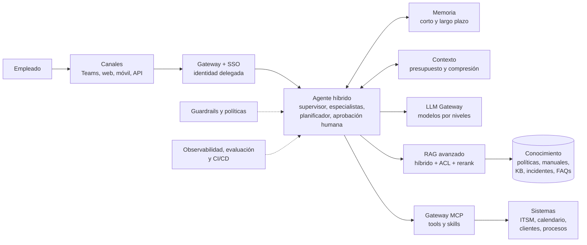

# Punto 2 - Agente Inteligente Corporativo Multicanal

Prueba técnica: **diseño de soluciones de IA basadas en agentes** para una entidad financiera. El agente permite a los empleados **consultar** información empresarial (políticas, manuales, procedimientos, base de conocimiento, incidentes, FAQs) y **ejecutar acciones** sobre sistemas internos (tickets, estados, reuniones, clientes, procesos).

Este entregable es un **diseño de referencia**: documentos y diagramas. No se desarrolla la aplicación, como indica el enunciado.

---

## Cómo leer esta documentación

| Si tienes... | Lee... |
|---|---|
| 2 minutos | El **resumen ejecutivo** y el diagrama de abajo |
| 10 minutos | [01 Arquitectura](docs/01_arquitectura_general.md) y [02 Agente](docs/02_diseno_del_agente.md) |
| Revisión completa | Los documentos 01 a 08 en orden; cada uno enlaza al anterior y al siguiente |

Los diagramas están escritos en **Mermaid** dentro de los documentos (se ven directamente en GitHub, GitLab y VS Code con la extensión *Markdown Preview Mermaid Support*). Además, están exportados como imágenes en [`diagramas/`](diagramas/).

---

## Mapa: requisito del enunciado → documento

| # | Requisito del enunciado | Documento | Diagramas incluidos |
|---|---|---|---|
| 1 | **Arquitectura general**: frontend/canal, orquestador, LLMs, memoria, etc., con justificación | [01. Arquitectura general](docs/01_arquitectura_general.md) | Contexto, arquitectura detallada, secuencia de una petición |
| 2 | **Diseño del agente**: tipo de agente con justificación técnica | [02. Diseño del agente](docs/02_diseno_del_agente.md) | Grafo del agente |
| 3 | **Sistema de memoria**: corto y largo plazo; almacenamiento y recuperación | [03. Sistema de memoria](docs/03_sistema_de_memoria.md) | Capas de memoria, recuperación, escritura |
| 4 | **Diseño del contexto**: qué contexto, cómo se construye, compresión | [04. Diseño del contexto](docs/04_diseno_del_contexto.md) | Ensamblado de contexto |
| 5 | **Diseño de RAG**: tipo y justificación | [05. Diseño de RAG](docs/05_diseno_rag.md) | Ingesta, consulta |
| 6 | **Tools y skills**: objetivo, inputs, outputs, manejo de errores | [06. Tools y skills](docs/06_tools_y_skills.md) | Gateway de herramientas |
| 7 | **Observabilidad, monitoreo, CI/CD**: guardrails, harness y pipelines | [07. Observabilidad, guardrails y CI/CD](docs/07_observabilidad_guardrails_cicd.md) | Ciclo cerrado, observabilidad, guardrails, harness, pipeline CI/CD |
| — | Decisiones, gestión de proyecto y uso óptimo de recursos | [08. Decisiones, gestión y recursos](docs/08_decisiones_gestion_y_recursos.md) | Hoja de ruta (Gantt) |

---

## Resumen ejecutivo

**Propuesta**: un agente **híbrido** montado sobre un **grafo con estado**. Un *supervisor* clasifica la intención y delega en **especialistas con tool calling** (conocimiento, mesa de servicio, clientes). Solo los procesos multi-paso pasan por un **planificador-ejecutor**, y toda acción de riesgo requiere **aprobación humana**. La regla es *determinismo donde importa, autonomía donde aporta*.

| Tema | Decisión | Documento |
|---|---|---|
| Canales | Teams/Slack, portal web, app móvil y API detrás de un único backend | 01 |
| Seguridad | Identidad delegada (OBO): el agente nunca tiene más permisos que el usuario; ACL en la recuperación; políticas como código (OPA) | 01, 06, 07 |
| Modelos | Estrategia **por niveles** (pequeño, principal, razonamiento) tras un LLM Gateway, en nube privada, con *fallback* | 01 |
| Agente | Híbrido: supervisor + especialistas Tool Calling + planificador condicionado + HITL | 02 |
| Memoria | Corto plazo en Redis (resumen progresivo); largo plazo en PostgreSQL + pgvector (preferencias y contexto histórico), con política de qué se recuerda | 03 |
| Contexto | Capas con presupuesto de tokens (~14 mil de entrada por turno), compresión por prioridad, *prompt caching* y delimitación de contenido no confiable | 04 |
| RAG | **Avanzado** (híbrido + ACL + rerank + citas + verificación) con **componente agéntico** acotado; GraphRAG para incidentes en fase 2 | 05 |
| Tools | Servidores **MCP** tras un gateway, con contrato de errores común, idempotencia, reintentos y compensación; 8 tools y 3 skills detalladas | 06 |
| Calidad y seguridad | Guardrails en 4 capas, harness de evaluación como **puerta de calidad** en CI/CD y evaluación en línea | 07 |
| Entrega | Pipelines de aplicación, conocimiento, evaluación y prompts; canario y rollback automático | 07 |
| Gestión | 4 fases con criterios *go / no-go*, riesgos, KPIs y equipo | 08 |
| Recursos | Enrutamiento por niveles, contexto mínimo, cachés, ingesta incremental y topes de costo | 04, 08 |

### Vista general



---

## Cumplimiento de los criterios de evaluación

| Criterio | Cómo se atiende |
|---|---|
| Diseño organizado y navegable | Un documento por requisito, numerados como el enunciado, con índice, navegación anterior/siguiente y tablas |
| Comunicación de ideas y gestión de proyecto | Resumen ejecutivo, ADR, hoja de ruta con criterios de salida, riesgos, equipo, KPIs ([doc 08](docs/08_decisiones_gestion_y_recursos.md)) |
| Uso de componentes del ecosistema analítico | LLMs, embeddings, rerankers, búsqueda híbrida, orquestación con LangGraph, MCP, OPA, OpenTelemetry/Langfuse, evaluación con RAGAS/promptfoo, mapeo a AWS, Azure y GCP |
| Uso óptimo de recursos | Enrutamiento por niveles, presupuesto de tokens, cachés, ingesta incremental, reutilización de servicios existentes ([doc 04](docs/04_diseno_del_contexto.md) y [doc 08](docs/08_decisiones_gestion_y_recursos.md)) |

---

## Estructura de la carpeta

```
punto-2-agentes/
├── README.md                              (este documento)
├── docs/
│   ├── 01_arquitectura_general.md
│   ├── 02_diseno_del_agente.md
│   ├── 03_sistema_de_memoria.md
│   ├── 04_diseno_del_contexto.md
│   ├── 05_diseno_rag.md
│   ├── 06_tools_y_skills.md
│   ├── 07_observabilidad_guardrails_cicd.md
│   └── 08_decisiones_gestion_y_recursos.md
└── diagramas/                             (imágenes exportadas y fuentes .mmd)
```

## Supuestos

- Entidad financiera regulada en Colombia (Ley 1581 de 2012 y políticas internas de seguridad de la información).
- Aproximadamente 5.000 empleados y ~300 conversaciones concurrentes en pico.
- Nube privada con acceso a modelos de lenguaje comerciales o abiertos, y sistemas internos con API (ITSM, calendario, CRM/core, BPM).
- Los valores numéricos (umbrales, plazos, metas) son **puntos de partida** a calibrar con datos reales.
