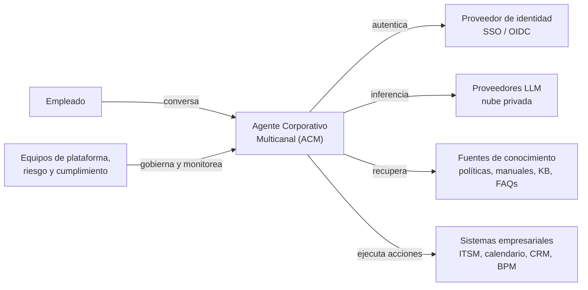
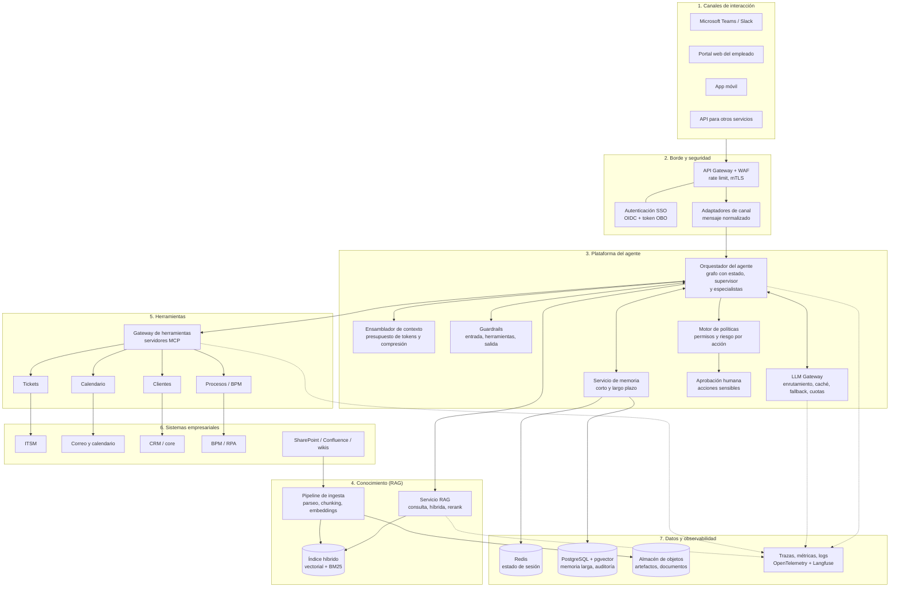
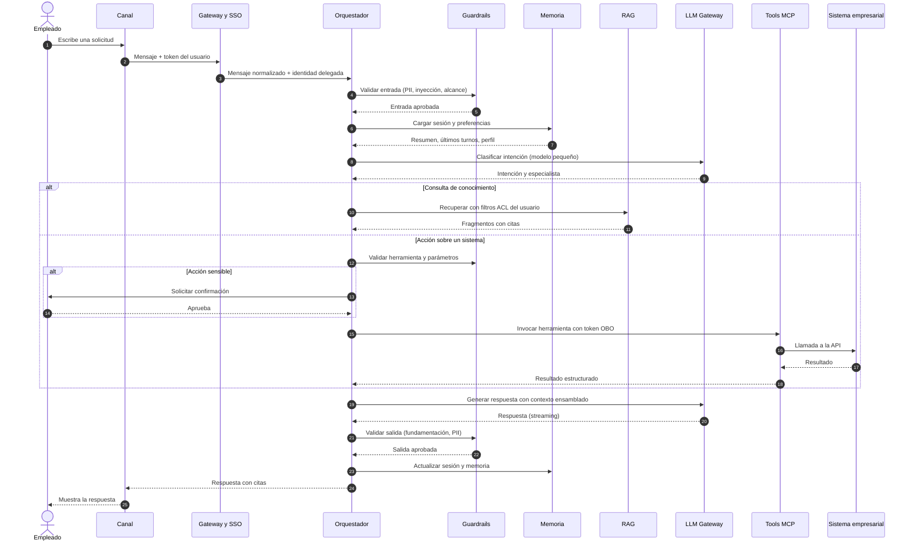

# 01. Arquitectura general

> Responde al punto **1. Arquitectura General** del enunciado: frontend/canales, orquestador, LLMs, memoria, y el resto de componentes, cada uno con su justificación.

[← Volver al índice](../README.md) · Siguiente: [02. Diseño del agente](02_diseno_del_agente.md)

---

## 1. Objetivo y requisitos

Un **Agente Corporativo Multicanal (ACM)** para empleados de una entidad financiera que:

- **Consulta** políticas, manuales, procedimientos, base de conocimiento, incidentes históricos y FAQs.
- **Actúa** sobre sistemas internos mediante herramientas: crear tickets, consultar estados, agendar reuniones, consultar clientes y lanzar procesos.

### Requisitos no funcionales (supuestos de diseño)

Los valores son metas de diseño razonables para un piloto corporativo; se ajustan con datos reales.

| Atributo | Meta | Cómo se cumple (sección) |
|---|---|---|
| Latencia primer token | P95 < 3 s | Streaming, modelo pequeño para enrutamiento, caché (§5, §6) |
| Latencia respuesta completa (consulta simple) | P95 < 12 s | RAG con reranker acotado, presupuesto de pasos |
| Disponibilidad | 99,5 % mensual | Multi-AZ, failover entre proveedores LLM |
| Seguridad | El agente nunca excede los permisos del usuario | Identidad delegada (OBO), ACL en RAG, políticas en tools (§8) |
| Trazabilidad | 100 % de acciones de escritura auditadas | Log de auditoría inmutable (§8, doc 07) |
| Privacidad | Cumplimiento de Ley 1581 de 2012 y políticas internas | Minimización, enmascaramiento de PII, residencia de datos |
| Escalabilidad | ~5.000 empleados, ~300 conversaciones concurrentes en pico | Servicios sin estado + autoescalado |
| Costo | Costo por conversación monitoreado y con tope | Enrutamiento por niveles de modelo, caché, compresión (doc 08) |

---

## 2. Diagrama de contexto

---

## 3. Arquitectura detallada

### Flujo de una petición

---

## 4. Justificación de cada componente

| # | Componente | Función | Tecnología recomendada | Alternativas | Por qué |
|---|---|---|---|---|---|
| 1 | **Canales** | Donde el empleado ya trabaja | Teams/Slack (bot), portal web, app móvil, API | WhatsApp corporativo, voz | Menor fricción de adopción; un único backend para todos |
| 2 | **Adaptadores de canal** | Normalizar mensajes, adjuntos y formato de respuesta | Servicio ligero (FastAPI) por canal | Lógica en cada canal | El agente no depende del canal; se agrega uno nuevo sin tocar el núcleo |
| 3 | **API Gateway + WAF** | Entrada única, rate limit, mTLS, protección OWASP | Gateway de la nube o Kong/Apigee | Balanceador simple | Control central de acceso y abuso |
| 4 | **Identidad (SSO + OBO)** | Autenticar y propagar la identidad al backend | OIDC con el IdP corporativo (Entra ID, Okta) | Cuenta de servicio única | El agente actúa **como el usuario**: no escala privilegios |
| 5 | **Orquestador** | Controla el ciclo del agente, estado, reintentos, aprobaciones | **LangGraph** (grafo con estado, checkpoints, interrupciones HITL) | Semantic Kernel, ADK, agentes administrados de la nube | Flujos deterministas donde importa y autonomía acotada; ver doc 02 |
| 6 | **LLM Gateway** | Un punto para modelos: enrutamiento, caché, fallback, cuotas, registro | LiteLLM / gateway de la nube | Llamar al proveedor directo | Evita dependencia de un proveedor, controla costo y centraliza guardrails |
| 7 | **Modelos LLM** | Razonamiento, tool calling, redacción | Estrategia por niveles (§5) | Un solo modelo grande | Optimiza costo y latencia manteniendo calidad |
| 8 | **Ensamblador de contexto** | Construye el prompt dentro de un presupuesto de tokens | Módulo propio | Concatenar todo | Calidad, costo y seguridad; ver doc 04 |
| 9 | **Servicio de memoria** | Estado de sesión y memoria de largo plazo | Redis + PostgreSQL/pgvector | Solo vector DB | Latencia baja para sesión; consultas relacionales y semánticas para largo plazo; ver doc 03 |
| 10 | **Servicio RAG** | Recuperación fundamentada con control de acceso | RAG avanzado con componente agéntico | RAG ingenuo | Precisión, citas y seguridad; ver doc 05 |
| 11 | **Índice híbrido** | Búsqueda vectorial + léxica con filtros de metadatos | OpenSearch / Azure AI Search / pgvector + BM25 | Solo vectorial | Los términos exactos (códigos, normas) fallan en vectorial puro |
| 12 | **Pipeline de ingesta** | Mantener el conocimiento actualizado y con permisos | Conectores + Airflow/eventos | Cargas manuales | Frescura y trazabilidad de versiones |
| 13 | **Gateway de herramientas (MCP)** | Exponer tools con contrato estándar, permisos y auditoría | Servidores MCP detrás de gateway | Funciones embebidas en el agente | Desacopla equipos, reutiliza tools con otros agentes; ver doc 06 |
| 14 | **Motor de políticas** | Decide qué acciones puede ejecutar y cuáles requieren aprobación | OPA (políticas como código) | `if` en el código | Auditable, versionado y revisable por riesgo |
| 15 | **Guardrails** | Protección en entrada, herramientas y salida | Capas: DLP/PII, clasificador de inyección, validación de esquemas, verificador de fundamentación | Solo prompt de sistema | Un prompt no es un control de seguridad; ver doc 07 |
| 16 | **Observabilidad** | Trazas, métricas, costos, evaluación en línea | OpenTelemetry + Langfuse + Grafana | Solo logs | Sin trazas por paso no se depura un agente |
| 17 | **Auditoría** | Registro inmutable de acciones | Tabla append-only + almacenamiento WORM | Logs de aplicación | Requisito regulatorio y de investigación de incidentes |

---

## 5. Estrategia de modelos LLM

Se recomienda **una familia de modelos por niveles**, accesibles por el LLM Gateway y desplegados en la **nube privada de la entidad** (sin entrenamiento con datos del cliente, residencia y cifrado contractuales). La elección final del modelo concreto se hace con una **comparación en el conjunto de oro** (doc 07), no por reputación.

| Nivel | Uso | Clase de modelo (ejemplos) | Participación objetivo del tráfico |
|---|---|---|---|
| **S** (pequeño, rápido) | Clasificación de intención, reescritura de consulta, extracción de memoria, compresión, guardrails ligeros | Clase "Haiku", "mini" o "Flash" | 40 – 50 % de las llamadas |
| **M** (principal) | Tool calling, respuestas con RAG, diálogo | Clase "Sonnet" o GPT-4.1 / Gemini Pro | 45 – 55 % |
| **L** (razonamiento) | Planificación de procesos complejos, casos ambiguos, juez de evaluación offline | Clase "Opus" o modelos de razonamiento | < 5 % |
| **Embeddings** | Vectorizar texto en español | `text-embedding-3-large`, Cohere embed multilingüe o `bge-m3` (abierto) | n/a |
| **Reranker** | Reordenar resultados | Cohere Rerank multilingüe o `bge-reranker-v2-m3` | n/a |
| **Modelos de seguridad** | Detección de contenido dañino e inyección | Llama Guard, Azure AI Content Safety, Bedrock Guardrails | n/a |

Criterios de selección: calidad en español financiero, fiabilidad de *tool calling*, latencia, costo por token, ventana de contexto, residencia de datos, acuerdos de no retención, y capacidad de **fallback** a un segundo proveedor.

Reglas del gateway:

- **Enrutamiento**: empieza en el nivel más barato que cumple; escala a M o L si la confianza es baja o la tarea lo exige.
- **Caché semántica** para FAQs repetidas y **caché de prefijo** (*prompt caching*) para el prompt de sistema estable.
- **Fallback**: si un proveedor falla o excede la latencia, se reintenta en el segundo. Las versiones de modelo se **fijan** (no `latest`).
- **Cuotas y presupuesto** por usuario, área y canal.

---

## 6. Despliegue e infraestructura

- **Contenedores en Kubernetes**, multi-zona, servicios sin estado con autoescalado horizontal (HPA) por concurrencia.
- **Red privada**: acceso a LLMs, bases de datos y sistemas internos por *private endpoints*; sin salida a internet salvo lista de permitidos.
- **Entornos**: dev, staging (con datos sintéticos) y producción, aislados.
- **Infraestructura como código** (Terraform) y despliegue **GitOps** (ver doc 07).

| Capacidad | AWS | Azure | GCP |
|---|---|---|---|
| Modelos | Bedrock | Azure OpenAI / AI Foundry | Vertex AI |
| Búsqueda híbrida | OpenSearch | Azure AI Search | Vertex AI Search / pgvector |
| Cómputo | EKS | AKS | GKE |
| Identidad | IAM Identity Center + IdP | Entra ID | Cloud Identity |
| Secretos | Secrets Manager | Key Vault | Secret Manager |
| Guardrails gestionados | Bedrock Guardrails | Content Safety | Model Armor |

El diseño es **agnóstico a la nube**; la tabla permite adaptarlo a la plataforma que ya use la organización (reutilizar lo existente es parte del uso óptimo de recursos).

---

## 7. Seguridad transversal (resumen)

| Riesgo | Control |
|---|---|
| Escalamiento de privilegios | Identidad delegada (OBO) y autorización en cada herramienta |
| Fuga entre áreas | Filtros ACL en la recuperación (*security trimming*) |
| Inyección de prompt (directa o en documentos) | Contenido recuperado tratado como **dato**, no como instrucción; clasificador de inyección; lista cerrada de tools |
| Acciones destructivas | Niveles de riesgo y aprobación humana; idempotencia y compensación |
| Datos personales de clientes | Mínimo necesario, enmascaramiento, propósito de uso registrado |
| Exposición de secretos | Bóveda de secretos; el modelo nunca ve credenciales |
| Falta de trazabilidad | Auditoría inmutable de cada acción con usuario, parámetros y resultado |

Detalle de guardrails, evaluación y pipelines: [07. Observabilidad, guardrails y CI/CD](07_observabilidad_guardrails_cicd.md).

---

[← Volver al índice](../README.md) · Siguiente: [02. Diseño del agente](02_diseno_del_agente.md)
