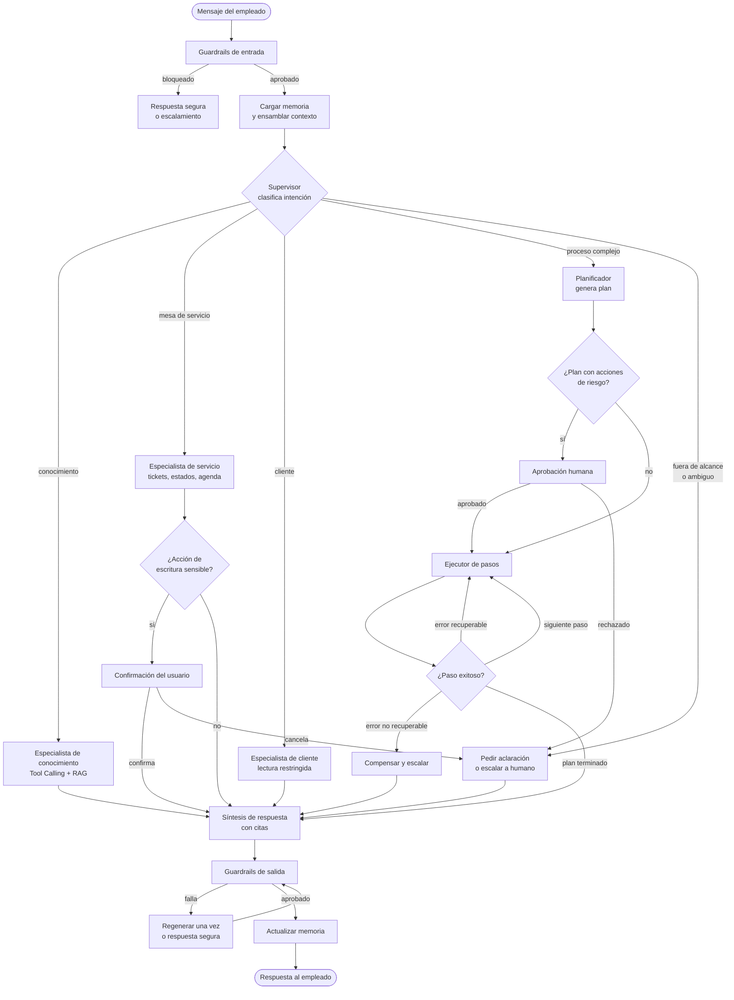

# 02. Diseño del agente

> Responde al punto **2. Diseño del Agente**: tipo de agente con justificación técnica.

[← Anterior: 01. Arquitectura](01_arquitectura_general.md) · [Índice](../README.md) · Siguiente: [03. Memoria](03_sistema_de_memoria.md)

---

## 1. Decisión

**Agente híbrido**, construido sobre un **grafo con estado** (LangGraph), que combina:

1. **Supervisor / enrutador** (nivel de modelo S): clasifica la intención y delega.
2. **Especialistas con *Tool Calling*** (nivel M): cada uno con pocas herramientas y un prompt corto. El bucle interno es ReAct acotado: razonar, llamar herramienta, observar, repetir con un máximo de pasos.
3. **Planner-Executor solo para procesos multi-paso** (nivel L para planificar, M para ejecutar): se activa únicamente cuando hay que lanzar procesos internos que encadenan varias acciones.
4. **Aprobación humana (HITL)** como nodo del grafo para acciones de riesgo medio o alto.

> **Regla de diseño**: *determinismo donde importa, autonomía donde aporta*. El flujo general es un grafo explícito; el LLM decide dentro de cada nodo, no sobre la estructura del sistema.

---

## 2. Comparación de alternativas

| Criterio | ReAct puro | Tool Calling | Planner-Executor | Multi-Agent libre | **Híbrido (elegido)** |
|---|---|---|---|---|---|
| Predecibilidad | Baja (bucles largos) | Alta | Alta | Baja | **Alta** |
| Latencia | Media-alta | **Baja** | Alta (planifica primero) | Alta | **Baja en el 90 % de los casos** |
| Costo en tokens | Alto | **Bajo** | Medio-alto | Muy alto | **Bajo-medio** |
| Auditabilidad | Media | Alta | Alta (el plan es auditable) | Baja | **Alta** |
| Manejo de procesos multi-paso | Regular | Limitado | **Excelente** | Bueno | **Excelente** (donde se necesita) |
| Complejidad operativa | Baja | **Baja** | Media | Alta | Media |
| Riesgo de bucles / deriva | Alto | Bajo | Medio | Alto | **Bajo** (presupuestos y topes) |
| Ajuste al caso | Parcial | Cubre ~70 % | Cubre procesos | Excesivo | **Cubre todo el alcance** |

### Por qué no las otras opciones

- **ReAct puro**: útil para exploración, pero en un banco los bucles abiertos son difíciles de auditar y costosos. Se conserva solo como bucle interno acotado.
- **Solo Tool Calling con un único agente**: funciona bien al inicio, pero degrada cuando el agente tiene muchas herramientas y políticas en un mismo prompt (más de ~15 herramientas aumentan los errores de selección).
- **Planner-Executor global**: añade latencia y costo a consultas simples ("¿cuál es la política de viáticos?") que no necesitan plan.
- **Multi-agente conversacional libre**: costo y no determinismo no justificados; difícil de certificar ante riesgo y cumplimiento.

---

## 3. Grafo del agente

---

## 4. Especialistas

| Agente | Alcance | Herramientas | Nivel de modelo | Autonomía |
|---|---|---|---|---|
| **Supervisor** | Clasificar, extraer entidades, elegir especialista | Ninguna | S | Solo enruta |
| **Conocimiento** | Responder con políticas, manuales, procedimientos, KB, incidentes y FAQs | `search_knowledge`, `search_incidents` | M | Alta (solo lectura) |
| **Mesa de servicio** | Tickets, estados de solicitudes, reuniones | `create_ticket`, `get_request_status`, `schedule_meeting` | M | Media: confirma antes de crear o modificar |
| **Cliente** | Consulta de información de clientes | `get_customer_info` | M | Baja: lectura mínima, con propósito y auditoría |
| **Procesos** | Encadenar acciones y lanzar procesos internos | `launch_process` + las anteriores | L (plan) + M (ejecución) | Baja: plan aprobado antes de ejecutar |

La división reduce el contexto de cada agente (menos herramientas e instrucciones), mejora la precisión de selección de herramientas y permite **otorgar permisos distintos** a cada uno (mínimo privilegio).

---

## 5. Niveles de autonomía según riesgo

| Nivel | Tipo de acción | Ejemplos | Comportamiento |
|---|---|---|---|
| **R0** | Lectura de conocimiento | Buscar política o FAQ | Automático |
| **R1** | Lectura de datos del usuario | Estado de mis solicitudes, mi agenda | Automático con auditoría |
| **R2** | Escritura reversible o de bajo impacto | Crear ticket, agendar reunión | Confirmación breve del usuario |
| **R3** | Datos sensibles de clientes | Consultar información de cliente | Verificación de rol y propósito + auditoría reforzada |
| **R4** | Proceso con efecto operativo o financiero | Lanzar proceso interno | Plan visible + aprobación explícita (y del responsable si la política lo exige) |

El nivel lo decide el **motor de políticas** (OPA), no el modelo: el LLM propone, la política dispone.

---

## 6. Control del bucle y terminación

| Control | Valor inicial | Propósito |
|---|---|---|
| Pasos máximos por turno | 6 (especialistas), 12 (ejecutor de planes) | Evitar bucles |
| Llamadas repetidas idénticas | 2 | Detectar atasco |
| Tiempo máximo por turno | 30 s (con *streaming* de estado al usuario) | Experiencia y costo |
| Presupuesto de tokens por turno | Configurable por canal | Costo |
| Reintentos de regeneración de salida | 1 | Evitar ciclos del guardrail |
| Condición de salida | Respuesta final, aclaración o escalamiento humano | Terminación explícita |

Si se agota un presupuesto, el agente **no improvisa**: informa qué logró, qué falta y ofrece escalar a una persona o crear un ticket.

---

## 7. Estado, reanudación y concurrencia

- El **estado del grafo** (mensajes, plan, resultados de tools, aprobaciones pendientes) se persiste con un *checkpointer* (Redis para el estado caliente, PostgreSQL para durabilidad).
- Las **aprobaciones humanas** son interrupciones del grafo: la conversación se pausa y se reanuda al responder el usuario, incluso desde otro canal.
- Las acciones de escritura usan **claves de idempotencia** para que un reintento no duplique tickets ni procesos.

---

## 8. Selección del framework

| Opción | Ventajas | Limitaciones | Decisión |
|---|---|---|---|
| **LangGraph** | Grafo explícito, estado y *checkpoints*, interrupciones HITL, streaming, ecosistema de evaluación | Curva de aprendizaje | **Elegido** |
| Semantic Kernel | Buena integración con .NET y Azure | Menos control del grafo | Alternativa si el equipo es .NET |
| Agentes administrados de la nube | Rápido para prototipos | Menos control, mayor dependencia del proveedor | Útil para prueba de concepto |
| Orquestación propia | Control total | Mantenimiento y deuda técnica | Descartada |

---

## 9. Ruta de evolución

1. **MVP**: supervisor + especialista de conocimiento + mesa de servicio (R0 a R2).
2. **Fase 2**: especialista de clientes (R3) con auditoría reforzada.
3. **Fase 3**: planificador/ejecutor de procesos (R4) con aprobación humana.
4. Se separa un nuevo especialista solo cuando las **evaluaciones** muestran interferencia entre herramientas o prompts, no por anticipación.

---

[← Anterior: 01. Arquitectura](01_arquitectura_general.md) · [Índice](../README.md) · Siguiente: [03. Memoria](03_sistema_de_memoria.md)
