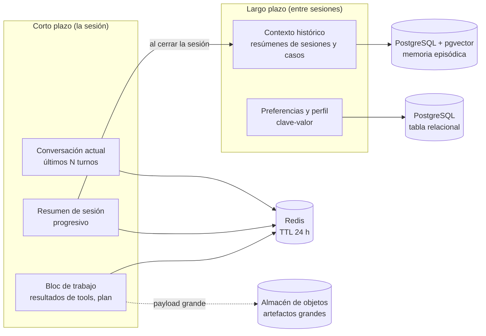
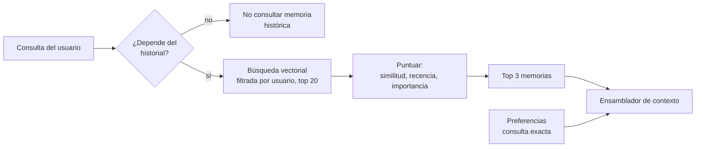
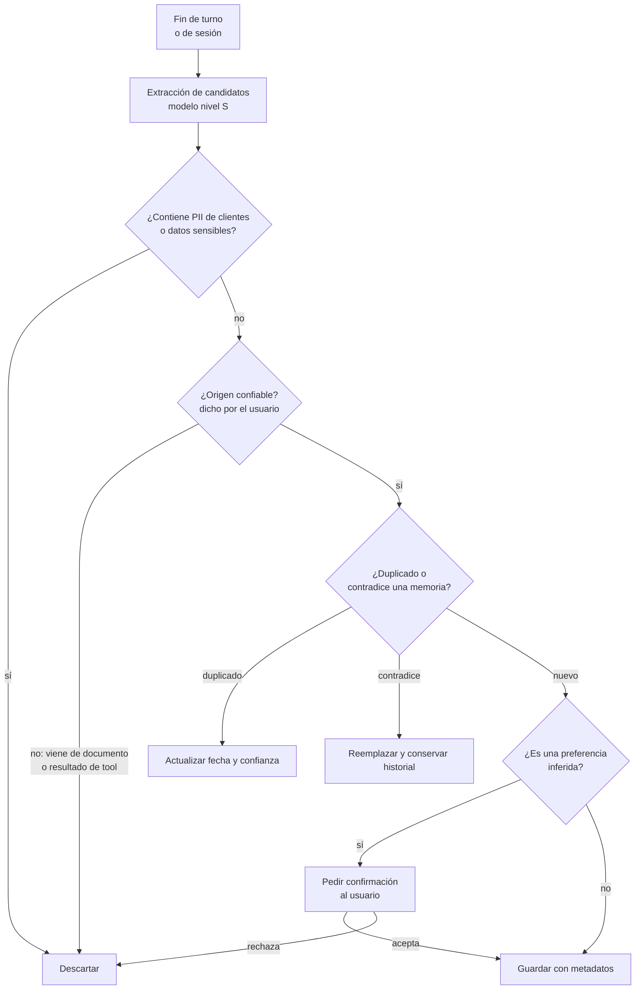

# 03. Diseño del sistema de memoria

> Responde al punto **3. Diseño del Sistema de Memoria**: memoria de corto y largo plazo, con almacenamiento y recuperación.

[← Anterior: 02. Agente](02_diseno_del_agente.md) · [Índice](../README.md) · Siguiente: [04. Contexto](04_diseno_del_contexto.md)

---

## 1. Visión general

Se separan **cuatro tipos de memoria** con ciclos de vida, almacenes y reglas de privacidad distintos. Mezclarlos en un solo almacén es un error común: la sesión actual necesita latencia mínima; las preferencias necesitan consulta exacta; el contexto histórico necesita búsqueda semántica.



| Memoria | Qué guarda | Almacén | Vida útil | Quién escribe |
|---|---|---|---|---|
| **Conversación actual** | Turnos recientes (usuario, agente, tools) | Redis (checkpointer del grafo) | Sesión + 24 h | Orquestador |
| **Resumen de sesión** | Resumen progresivo: objetivo, decisiones, pendientes | Redis | Sesión + 24 h | Modelo nivel S |
| **Bloc de trabajo** | Resultados de herramientas, plan y estado del proceso | Redis (+ objetos si es grande) | Sesión | Orquestador |
| **Preferencias y perfil** | Idioma, formato, canal preferido, área, zona horaria | PostgreSQL (relacional) | Hasta que el usuario las borre | Usuario o extracción confirmada |
| **Contexto histórico** | Resúmenes de sesiones pasadas, casos resueltos, temas frecuentes | PostgreSQL + pgvector | 12 meses (configurable) | Cierre de sesión (modelo S) |

---

## 2. Memoria de corto plazo

### Almacenamiento

- **Estado de la conversación** como *checkpoint* del grafo en **Redis**: lectura en milisegundos, expiración automática (TTL).
- **Durabilidad** (reanudar una aprobación pendiente tras reinicios): réplica en PostgreSQL de los checkpoints marcados como "pendiente".
- **Payloads grandes** (listados, documentos adjuntos): se guardan en el almacén de objetos y en el contexto solo viaja una **referencia** y un extracto.

### Recuperación y gestión

1. En cada turno se cargan: **resumen de sesión** + **últimos N turnos** (N = 6 por defecto) + **bloc de trabajo** relevante.
2. Cuando el historial supera el **70 %** de su presupuesto de tokens, se activa el **resumen progresivo**:
   - los turnos más antiguos se condensan en el resumen (objetivo, hechos confirmados, decisiones, pendientes, entidades como IDs de ticket);
   - se conservan **literales** los datos que no se pueden resumir sin perder precisión (números, IDs, fechas, nombres de políticas).
3. Al **cerrar la sesión** (inactividad de 30 min o cierre explícito) se genera un **resumen final** que alimenta la memoria histórica.

Ejemplo de resumen de sesión:

```json
{
  "session_id": "s-8f21",
  "objetivo": "Reportar caída del VPN y conocer la política de trabajo remoto",
  "hechos_confirmados": ["Usuario en sede Medellín", "VPN falla desde las 8:10"],
  "acciones_realizadas": [{"tool": "create_ticket", "id": "INC-48213", "estado": "creado"}],
  "pendientes": ["Confirmar reunión con soporte para el jueves"],
  "entidades": {"tickets": ["INC-48213"], "politicas": ["POL-RH-014"]}
}
```

---

## 3. Memoria de largo plazo

### 3.1 Preferencias de usuario (memoria semántica estructurada)

- **Qué**: idioma, nivel de detalle, formato de respuesta, canal y horario preferido, área y rol (este último proviene del IdP, **no** del modelo).
- **Almacén**: tabla relacional en PostgreSQL con clave `(user_id, clave)`.
- **Recuperación**: consulta exacta por `user_id` al inicio de sesión; se inyecta una versión compacta (< 150 tokens) en el contexto.

```sql
CREATE TABLE user_preferences (
  user_id      TEXT NOT NULL,
  clave        TEXT NOT NULL,
  valor        JSONB NOT NULL,
  origen       TEXT NOT NULL,      -- 'usuario' | 'inferido_confirmado' | 'idp'
  confianza    REAL DEFAULT 1.0,
  actualizado  TIMESTAMPTZ DEFAULT now(),
  PRIMARY KEY (user_id, clave)
);
```

### 3.2 Contexto histórico (memoria episódica)

- **Qué**: resúmenes de sesiones previas, casos resueltos y temas recurrentes ("la última vez se escaló el ticket INC-48213 a infraestructura").
- **Almacén**: PostgreSQL + **pgvector** (embedding del resumen) con metadatos: usuario, fecha, tema, importancia, ticket asociado.
- **Recuperación** (solo bajo demanda, para no inflar el contexto):
  1. El supervisor decide si la consulta depende del historial (expresiones como "la última vez" o "el ticket de ayer"). Si no depende, no se consulta la memoria histórica.
  2. Búsqueda vectorial **filtrada por `user_id`**, top 20.
  3. Puntuación combinada: `0,6 · similitud + 0,25 · recencia + 0,15 · importancia`.
  4. Se inyectan como máximo **3 memorias** (≈ 300 tokens), con fecha y fuente.



---

## 4. Escritura de memoria (qué se recuerda y qué no)



Reglas de la política de memoria:

1. **Nunca** se almacena información de clientes (nombres, cédulas, saldos) en la memoria del agente. Para eso existe la herramienta de clientes con auditoría.
2. **Solo se aprende de lo que dice el usuario**, no de contenido recuperado ni de resultados de herramientas. Esto evita el **envenenamiento de memoria** por inyección de prompts.
3. Las **preferencias inferidas** requieren confirmación explícita ("¿Quieres que te responda siempre de forma resumida?").
4. Cada memoria registra **origen, fecha, confianza y versión**.

---

## 5. Ciclo de vida, privacidad y gobierno

| Aspecto | Política |
|---|---|
| **Consentimiento y transparencia** | El empleado puede ver, editar y borrar su memoria ("¿Qué recuerdas de mí?", "Olvida esto") |
| **Retención** | Sesión: 24 h. Histórico: 12 meses y luego se consolida o elimina |
| **Olvido** | Borrado verificable por usuario; al salir de la empresa se eliminan sus memorias |
| **Aislamiento** | Todas las consultas filtradas por `user_id`; pruebas automáticas de no fuga entre usuarios |
| **Cifrado** | En tránsito y en reposo; claves gestionadas por el área de seguridad |
| **Residencia** | Dentro de la región y nube privada de la entidad |
| **Cumplimiento** | Ley 1581 de 2012 (protección de datos personales) y políticas internas de seguridad de la información |
| **Auditoría** | Cada lectura o escritura de memoria se registra con propósito |

---

## 6. Evaluación de la memoria

| Métrica | Qué mide | Meta inicial |
|---|---|---|
| Precisión de recuperación | % de memorias inyectadas que son relevantes | > 85 % |
| Tasa de memoria incorrecta | Memorias erróneas aplicadas en la respuesta | < 1 % |
| Fuga entre usuarios | Pruebas de aislamiento | 0 casos |
| Fidelidad del resumen | Resumen conserva IDs, fechas y decisiones (juez LLM + revisión humana) | > 95 % |
| Ahorro de tokens | Reducción frente a enviar todo el historial | > 60 % |

---

## 7. Decisiones de tecnología

| Decisión | Elegido | Alternativas | Motivo |
|---|---|---|---|
| Estado de sesión | Redis | DynamoDB, Cosmos DB | Latencia mínima y TTL nativo |
| Memoria larga | PostgreSQL + pgvector | Pinecone, Qdrant | Una sola base para datos relacionales y vectores; menos piezas que operar. Con volumen alto se migra a un motor vectorial dedicado |
| Resumen y extracción | Modelo nivel S | Modelo M | Tareas acotadas; ahorro de costo |

---

[← Anterior: 02. Agente](02_diseno_del_agente.md) · [Índice](../README.md) · Siguiente: [04. Contexto](04_diseno_del_contexto.md)
