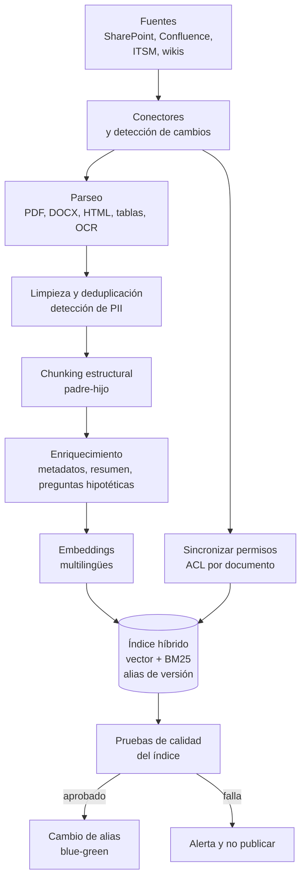
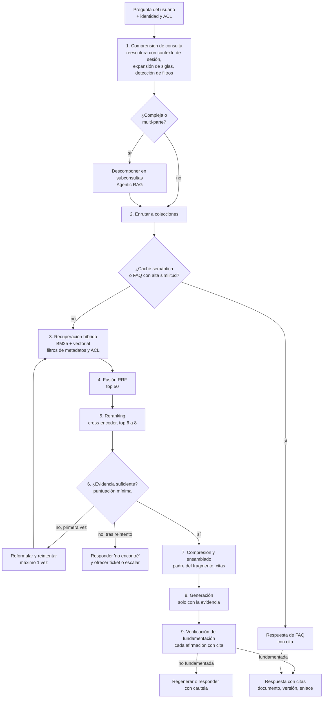

# 05. Diseño de RAG

> Responde al punto **5. Diseño de RAG**: tipo de RAG, con justificación.

[← Anterior: 04. Contexto](04_diseno_del_contexto.md) · [Índice](../README.md) · Siguiente: [06. Tools y skills](06_tools_y_skills.md)

---

## 1. Decisión

**RAG avanzado como base, con un componente agéntico acotado (Agentic RAG) para consultas complejas, y GraphRAG como evolución para incidentes históricos.**

| Tipo de RAG | ¿Se usa? | Justificación |
|---|---|---|
| Naive RAG (embed + top-k) | No como solución final | Falla con códigos y términos exactos (norma, número de política), no respeta permisos, no maneja versiones y degrada con corpus grande |
| **Advanced RAG** | **Sí, es la base** | Búsqueda híbrida, filtros de metadatos y ACL, reescritura de consulta, reranking, compresión, citas y verificación de fundamentación |
| **Agentic RAG** | **Sí, solo cuando hace falta** | Preguntas multi-parte o que cruzan fuentes ("¿qué dice la política de viáticos y hubo incidentes similares?"): el agente descompone, consulta varias colecciones e itera máximo 2 veces |
| **GraphRAG** | **Fase 2, solo incidentes** | Las relaciones servicio → incidente → causa raíz → solución se benefician de un grafo; para políticas y manuales no justifica su costo de construcción |
| Modular RAG / otros | Se adopta el enfoque modular | Cada etapa (reescritura, retriever, reranker, verificador) es reemplazable y medible por separado |

**Por qué esta combinación**: el contenido es heterogéneo (políticas normativas, procedimientos, FAQ, incidentes), exige **precisión y citas** (es un banco), **control de acceso por documento** y **frescura**. El RAG avanzado cubre eso a costo y latencia razonables. La parte agéntica se limita a los casos que la necesitan para no pagar su latencia en todas las consultas.

---

## 2. Fuentes y estrategia por tipo

| Fuente | Características | Estrategia de índice | Chunking | Metadatos clave |
|---|---|---|---|---|
| **Políticas internas** | Normativas, versionadas, con vigencia | Colección propia; solo versión vigente por defecto | Por sección y artículo, con título jerárquico; padre-hijo | `id_politica`, `versión`, `vigente_desde`, `vigente_hasta`, `dueño`, `área`, `nivel_confidencialidad` |
| **Manuales operativos** | Largos, con pasos y tablas | Colección propia | Estructural (encabezados), tablas como unidad, chunk hijo pequeño + padre | `sistema`, `proceso`, `versión`, `rol_aplicable` |
| **Procedimientos** | Pasos numerados | Colección propia | Un procedimiento completo es el padre; pasos como hijos | `proceso`, `área`, `riesgo` |
| **Base de conocimiento** | Artículos cortos | Colección propia | Por artículo o sección | `producto`, `tema`, `fecha_actualización` |
| **Incidentes históricos** | Estructurados + texto libre; el tiempo importa | Colección propia con filtros temporales; grafo en fase 2 | Un incidente = un documento con campos (síntoma, causa raíz, solución) | `servicio`, `severidad`, `fecha`, `causa_raíz`, `estado` |
| **FAQs** | Pregunta-respuesta | Índice de preguntas + **caché semántica** | Un par Q&A por unidad | `tema`, `última_revisión` |

---

## 3. Pipeline de ingesta

Puntos clave:

- **Actualización incremental** por eventos (webhooks) o sondeo programado; solo se reprocesan documentos cambiados.
- **Versionado**: cada documento conserva versiones; la búsqueda usa la **vigente** salvo petición histórica. Un documento retirado se **elimina** del índice activo.
- **Permisos**: se sincronizan las ACL de la fuente al índice. Un cambio de permisos debe reflejarse en minutos, no en días.
- **Calidad**: pruebas automáticas antes de publicar (conteo de documentos, muestras de recuperación, parseo correcto). Los índices se publican con **alias blue-green** para poder revertir.
- **Enriquecimiento**: resumen del documento y **preguntas hipotéticas** que el fragmento responde (mejora la recuperación en preguntas coloquiales).
- **Embeddings** multilingües con buen desempeño en español; el modelo queda fijado por versión (cambiar de embedding implica reindexar).

---

## 4. Pipeline de consulta

### Detalle de las etapas

| Etapa | Qué hace | Parámetros iniciales | Por qué |
|---|---|---|---|
| **1. Comprensión de consulta** | Reescribe la pregunta usando el resumen de sesión ("¿y para viajes al exterior?" → pregunta completa); extrae filtros (área, fecha, sistema) | Modelo nivel S | Las preguntas de seguimiento no se entienden sin el historial |
| **2. Enrutamiento** | Elige colecciones (políticas, manuales, incidentes, KB) según intención | Reglas + clasificador S | Evita buscar en todo y reduce ruido |
| **3. Recuperación híbrida** | BM25 + vectorial, **filtros ACL y de vigencia obligatorios** | 30 por método | Léxico para términos exactos; vectorial para semántica |
| **4. Fusión** | *Reciprocal Rank Fusion* | k = 60, top 50 | Combina rankings sin calibrar puntuaciones |
| **5. Reranking** | Cross-encoder multilingüe sobre top 50 | Se conservan 6 a 8 | Mayor mejora de precisión por costo |
| **6. Control de suficiencia** | Si la mejor puntuación no supera el umbral, no se responde "de memoria" | Umbral calibrado con el conjunto de oro | Evita alucinaciones |
| **7. Compresión y ensamblado** | Trae el **fragmento padre** para contexto, quita redundancias | ≤ 6.000 tokens | Contexto limpio (ver doc 04) |
| **8. Generación** | Responde **solo con la evidencia**, con citas | Modelo M | Fundamentación |
| **9. Verificación** | Comprueba que cada afirmación tiene respaldo; si no, regenera o suaviza | Verificador nivel S/M | Reduce alucinaciones en políticas |

### Componente agéntico (cuándo se activa)

El supervisor activa el modo agéntico si la consulta **cruza fuentes**, es **multi-parte** o la primera recuperación fue insuficiente. El agente puede descomponer, consultar varias colecciones y combinar resultados, con topes: **máximo 2 iteraciones y 4 subconsultas**. Esto acota latencia y costo.

---

## 5. Seguridad en RAG

- **Security trimming**: el filtro por ACL se aplica **en la consulta** al índice, con la identidad del usuario. Un fragmento al que el usuario no tiene acceso nunca llega al modelo, ni siquiera para "resumir".
- **Niveles de confidencialidad** en los metadatos: documentos restringidos solo se recuperan para roles autorizados.
- **Contenido no confiable**: los fragmentos van delimitados y se pasan por clasificador de inyección (ver doc 04 y 07).
- **Citas obligatorias**: toda respuesta de políticas muestra documento, versión y fecha de vigencia.
- **Auditoría**: se registra qué documentos se recuperaron para cada respuesta.

---

## 6. Evaluación del RAG

Se evalúa **recuperación** y **generación** por separado, offline (CI) y en línea (muestreo en producción).

| Métrica | Etapa | Meta inicial |
|---|---|---|
| Recall@10 / Hit rate | Recuperación | > 90 % |
| MRR / nDCG@8 | Recuperación + reranking | > 0,75 |
| Precisión de contexto | Ensamblado | > 0,80 |
| Fidelidad (*faithfulness*) | Generación | > 0,95 |
| Relevancia de la respuesta | Generación | > 0,90 |
| Citas correctas | Generación | > 95 % |
| Tasa de "no sé" correcta | Control de suficiencia | > 90 % en preguntas sin respuesta |
| Fuga por ACL | Seguridad | 0 casos en pruebas |
| Latencia de la etapa RAG | Operación | P95 < 2,5 s |

Herramientas: RAGAS o DeepEval y un conjunto de oro (preguntas reales de empleados con respuesta y documento fuente). Un cambio de chunking, embedding o reranker solo se despliega si **no empeora** el conjunto de oro.

---

## 7. Operación y fallos

| Situación | Comportamiento |
|---|---|
| Índice o reranker no disponible | Degradación: solo BM25 o sin rerank, marcando menor confianza |
| Sin evidencia suficiente | Lo dice, sugiere reformular, crear ticket o escalar a un humano |
| Documentos contradictorios | Prevalece el vigente y de mayor jerarquía; se informa la contradicción |
| Documento desactualizado detectado por el usuario | Retroalimentación ("pulgar abajo" con motivo) alimenta una cola de revisión al dueño del documento |
| Cambio de modelo de embeddings | Se construye un índice nuevo en paralelo y se cambia el alias tras pasar el conjunto de oro |

---

## 8. Evolución: GraphRAG para incidentes (fase 2)

Un grafo con nodos `Servicio`, `Incidente`, `Causa raíz`, `Solución`, `Cambio` y relaciones entre ellos permite preguntas como "¿qué otros servicios se vieron afectados por la misma causa raíz?". Se construye **solo** para incidentes, extrayendo entidades y relaciones con un LLM sobre el histórico, y se consulta junto con la búsqueda híbrida. Se justifica cuando las evaluaciones muestren que las preguntas relacionales son frecuentes y la búsqueda híbrida no las resuelve.

---

[← Anterior: 04. Contexto](04_diseno_del_contexto.md) · [Índice](../README.md) · Siguiente: [06. Tools y skills](06_tools_y_skills.md)
