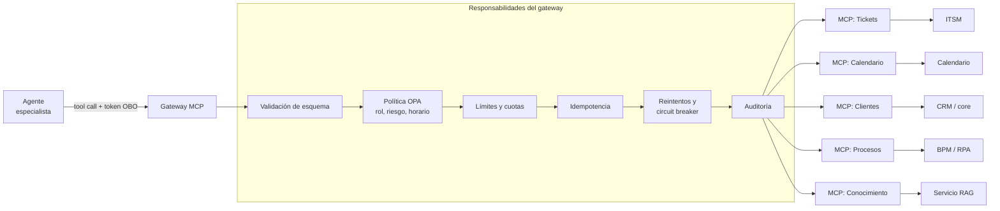

# 06. Diseño de tools y skills

> Responde al punto **6. Diseño de Tools y Skills**: para cada elemento, objetivo, inputs, outputs y manejo de errores.

[← Anterior: 05. RAG](05_diseno_rag.md) · [Índice](../README.md) · Siguiente: [07. Observabilidad y CI/CD](07_observabilidad_guardrails_cicd.md)

---

## 1. Conceptos y principios

| Concepto | Definición | Ejemplo |
|---|---|---|
| **Tool** | Capacidad **atómica** con contrato fijo (entrada y salida tipadas), que el agente invoca | `create_ticket` |
| **Skill** | Paquete de **conocimiento procedimental**: instrucciones, secuencia recomendada de tools, ejemplos y criterios de éxito. Se carga **bajo demanda** | "Reportar un incidente" |

Las tools son los **verbos**; las skills son la **receta** que dice cuándo y cómo combinarlos. Separarlas evita un prompt de sistema enorme: el agente carga la skill solo cuando la intención la requiere (divulgación progresiva).

Principios de diseño de tools:

1. **Pequeñas y con un solo propósito**, con nombres y descripciones claros para el modelo.
2. **Contrato estricto**: esquema JSON validado en entrada y salida.
3. **Mínimo privilegio**: cada tool recibe el **token del usuario (OBO)**, no una cuenta de servicio con permisos amplios.
4. **Idempotentes** en escrituras (clave de idempotencia) y **auditadas**.
5. **Salidas compactas**: devuelven lo necesario, no volcados completos (ver doc 04).
6. **Errores estructurados** y entendibles por el modelo (§4).
7. Expuestas como **servidores MCP** detrás de un gateway que centraliza autenticación, autorización, límites y registro.

---

## 2. Arquitectura del gateway de herramientas



---

## 3. Catálogo

| # | Tool | Tipo | Riesgo | Especialista | Confirmación |
|---|---|---|---|---|---|
| 1 | `search_knowledge` | Lectura | R0 | Conocimiento | No |
| 2 | `search_incidents` | Lectura | R0 | Conocimiento | No |
| 3 | `get_request_status` | Lectura | R1 | Mesa de servicio | No |
| 4 | `create_ticket` | Escritura | R2 | Mesa de servicio | Sí (resumen antes de crear) |
| 5 | `schedule_meeting` | Escritura | R2 | Mesa de servicio | Sí |
| 6 | `get_customer_info` | Lectura sensible | R3 | Cliente | Rol + propósito |
| 7 | `launch_process` | Escritura crítica | R4 | Procesos | Plan aprobado |
| 8 | `escalate_to_human` | Escritura | R1 | Todos | No |
| 9 | `memory_read` / `memory_write` | Interna | R1 | Orquestador | Política de memoria (doc 03) |

| Skill | Objetivo | Tools que orquesta |
|---|---|---|
| `reportar_incidente` | Guiar el reporte completo de un incidente | `search_incidents`, `search_knowledge`, `create_ticket` |
| `consulta_politica_con_cita` | Responder una política con versión y vigencia | `search_knowledge` |
| `agendar_reunion_soporte` | Coordinar una reunión con un equipo | `get_request_status`, `schedule_meeting` |
| `consultar_cliente_seguro` | Consultar un cliente con propósito y enmascaramiento | `get_customer_info` |
| `lanzar_proceso_aprobado` | Ejecutar un proceso con plan, aprobación y verificación | `launch_process`, `get_request_status` |

---

## 4. Manejo de errores (contrato común a todas las tools)

### 4.1 Estructura del error

Toda tool devuelve el mismo formato para que el modelo y el orquestador decidan sin adivinar:

```json
{
  "ok": false,
  "error": {
    "codigo": "UPSTREAM_TIMEOUT",
    "reintentable": true,
    "mensaje_para_modelo": "El sistema ITSM no respondió en 8 s. No se creó el ticket.",
    "mensaje_para_usuario": "El sistema de tickets está lento. Puedo reintentar o avisarte cuando responda.",
    "detalle_tecnico_id": "trace-7f3a...",
    "reintentar_despues_ms": 2000
  }
}
```

### 4.2 Taxonomía y reacción

| Código | Causa | ¿Reintento? | Reacción del agente |
|---|---|---|---|
| `VALIDATION_ERROR` | Parámetros inválidos o faltantes | No | El agente corrige o **pregunta al usuario** el dato faltante |
| `UNAUTHORIZED` / `FORBIDDEN` | Sin permiso o token vencido | No | Informa que no tiene permiso; **no** intenta rodearlo; ofrece escalar |
| `NOT_FOUND` | El recurso no existe | No | Pide verificar el identificador |
| `CONFLICT` / `DUPLICATE` | Ya existe (idempotencia) | No | Devuelve el recurso existente |
| `RATE_LIMITED` | Límite excedido | Sí, con espera | Espera y reintenta o informa demora |
| `UPSTREAM_TIMEOUT` / `UPSTREAM_5XX` | Falla del sistema destino | Sí (solo idempotentes) | Reintenta con retroceso exponencial; si persiste, degrada |
| `BUSINESS_RULE` | Regla de negocio incumplida (p. ej. sala ocupada) | No | Explica la regla y propone alternativas |
| `POLICY_DENIED` | El motor de políticas bloqueó la acción | No | Informa el motivo y ofrece aprobación humana |
| `UNKNOWN` | Error inesperado | No | Registra, no inventa un resultado, escala |

### 4.3 Reglas de resiliencia

| Mecanismo | Configuración inicial |
|---|---|
| **Tiempos máximos** | Lectura 5 s; escritura 10 s; proceso asíncrono: devuelve `job_id` |
| **Reintentos** | Hasta 3, retroceso exponencial con *jitter* (500 ms, 1 s, 2 s), **solo operaciones idempotentes** |
| **Idempotencia** | Clave `idempotency_key` = hash(usuario, tool, parámetros normalizados, ventana de 5 min) |
| **Circuit breaker** | Se abre tras 5 fallos en 30 s; respuestas rápidas de "servicio no disponible" y medio-abierto tras 30 s |
| **Degradación** | Si ITSM cae: el agente ofrece guardar la solicitud en cola y notificar al restablecerse |
| **Compensación (saga)** | En procesos multi-paso, cada paso define su acción inversa; si falla uno, se deshacen los previos y se escala |
| **Nunca inventar** | Ante error, el agente jamás afirma que la acción se hizo; confirma con el estado real (`get_request_status`) |
| **Validación de salida** | Esquema de respuesta validado; si el sistema destino devuelve algo inesperado se trata como `UPSTREAM_ERROR` |

---

## 5. Especificación de cada tool

### 5.1 `search_knowledge`

| | |
|---|---|
| **Objetivo** | Recuperar fragmentos fundamentados de políticas, manuales, procedimientos, KB y FAQs, respetando permisos |
| **Inputs** | `query` (string, requerido) · `colecciones` (array de `politicas` `manuales` `procedimientos` `kb` `faq`; opcional) · `filtros` (`area`, `sistema`, `vigente_en`; opcional) · `top_k` (int, defecto 6, máx. 10) |
| **Outputs** | `resultados[]`: `texto`, `documento_id`, `titulo`, `version`, `vigente_desde`, `url`, `puntuación` · `suficiente` (bool) · `trace_id` |
| **Errores** | `VALIDATION_ERROR` (consulta vacía) · `UPSTREAM_TIMEOUT` (índice lento → reintento y degradación a BM25) · `suficiente=false` (no es un error: el agente responde "no encontré") |
| **Riesgo / control** | R0; filtro ACL obligatorio con la identidad del usuario |

### 5.2 `search_incidents`

| | |
|---|---|
| **Objetivo** | Encontrar incidentes históricos similares para diagnóstico y sugerir soluciones conocidas |
| **Inputs** | `descripcion` (string, requerido) · `servicio` (string) · `desde` / `hasta` (fecha) · `severidad` (enum) · `top_k` (defecto 5) |
| **Outputs** | `incidentes[]`: `id`, `titulo`, `servicio`, `fecha`, `causa_raiz`, `solucion`, `similitud` |
| **Errores** | `VALIDATION_ERROR` · `UPSTREAM_TIMEOUT` · lista vacía (se indica que no hay antecedentes) |
| **Riesgo / control** | R0; solo incidentes que el rol del usuario puede ver |

### 5.3 `get_request_status`

| | |
|---|---|
| **Objetivo** | Consultar el estado de una solicitud o ticket del usuario |
| **Inputs** | `request_id` (string, requerido; patrón `INC-`, `REQ-`) o `solo_mias=true` con `estado` (opcional) |
| **Outputs** | `id`, `tipo`, `estado`, `asignado_a`, `ultima_actualizacion`, `siguiente_paso`, `sla_vence` |
| **Errores** | `NOT_FOUND` (ID inexistente → pedir verificación) · `FORBIDDEN` (no es del usuario ni de su equipo) · `UPSTREAM_TIMEOUT` (reintento 3 veces) |
| **Riesgo / control** | R1; el sistema destino valida propiedad con el token del usuario |

### 5.4 `create_ticket`

| | |
|---|---|
| **Objetivo** | Crear un ticket (incidente, requerimiento o cambio) en la mesa de servicio |
| **Inputs** | `tipo` (enum `incidente` `requerimiento` `cambio`) · `titulo` (string ≤ 120) · `descripcion` (string) · `categoria` · `prioridad` (enum; el agente propone, la política valida) · `servicio_afectado` · `adjuntos[]` (referencias a objetos) · `idempotency_key` |
| **Outputs** | `ticket_id`, `estado`, `url`, `sla`, `grupo_asignado` |
| **Errores** | `VALIDATION_ERROR` (campos faltantes → preguntar al usuario) · `DUPLICATE` (ticket similar abierto → ofrecer enlazar) · `UPSTREAM_TIMEOUT` (verificar por idempotencia si se creó antes de reintentar) · `POLICY_DENIED` (prioridad crítica sin autorización) |
| **Riesgo / control** | R2: el agente muestra un **resumen y pide confirmación** antes de crear; se audita contenido y resultado |

### 5.5 `schedule_meeting`

| | |
|---|---|
| **Objetivo** | Agendar una reunión validando disponibilidad |
| **Inputs** | `asunto` · `participantes[]` (correos corporativos) · `inicio` y `fin` (ISO 8601 con zona) o `duracion_min` + `ventana` · `modalidad` (`virtual` `presencial`) · `sala` (opcional) · `descripcion` |
| **Outputs** | `evento_id`, `inicio`, `fin`, `enlace`, `participantes_confirmados`, `conflictos[]` |
| **Errores** | `BUSINESS_RULE` (conflicto de agenda → proponer 3 alternativas) · `NOT_FOUND` (participante inexistente) · `FORBIDDEN` (agenda privada) · `VALIDATION_ERROR` (fechas inválidas) |
| **Riesgo / control** | R2; confirmación de fecha, hora y participantes antes de enviar invitaciones; zona horaria explícita |

### 5.6 `get_customer_info`

| | |
|---|---|
| **Objetivo** | Consultar datos de un cliente para resolver una gestión interna |
| **Inputs** | `identificador_cliente` (string) · `campos` (lista cerrada, p. ej. `estado_productos`, `segmento`, `contactos`) · `proposito` (enum, requerido: `soporte_caso`, `gestion_comercial`, etc.) · `caso_id` (requerido) |
| **Outputs** | Solo los campos solicitados y **enmascarados por defecto** (`***1234`); `nivel_enmascaramiento`; `acceso_id` (auditoría) |
| **Errores** | `FORBIDDEN` (el rol no habilita al empleado para ese cliente o campo) · `NOT_FOUND` · `POLICY_DENIED` (propósito no coincide con el caso) · `RATE_LIMITED` (límite de consultas por empleado, contra uso indebido) |
| **Riesgo / control** | R3: rol y propósito verificados por política, acceso con `caso_id`, **auditoría reforzada** y alertas por patrones anómalos. Los datos **no** se guardan en memoria del agente |

### 5.7 `launch_process`

| | |
|---|---|
| **Objetivo** | Lanzar un proceso interno aprobado (BPM/RPA), por ejemplo alta de acceso o provisión de recurso |
| **Inputs** | `proceso_id` (de un catálogo cerrado) · `parametros` (esquema propio por proceso) · `justificacion` · `aprobacion_id` (requerido para R4) · `idempotency_key` |
| **Outputs** | `job_id`, `estado` (`en_cola` `en_curso`), `url_seguimiento`, `eta`, `pasos[]` |
| **Errores** | `POLICY_DENIED` (sin aprobación) · `VALIDATION_ERROR` · `CONFLICT` (proceso ya en ejecución) · `UPSTREAM_5XX` (no reintentar sin verificar el `job_id`) · fallo a mitad de proceso → **compensación** y escalamiento |
| **Riesgo / control** | R4: **plan visible y aprobación explícita**, catálogo cerrado de procesos, ejecución asíncrona con seguimiento por `get_request_status` |

### 5.8 `escalate_to_human`

| | |
|---|---|
| **Objetivo** | Transferir la conversación a una persona con el contexto resumido |
| **Inputs** | `motivo` (enum `sin_evidencia` `fuera_de_alcance` `error_sistema` `solicitud_usuario` `riesgo`) · `resumen` (≤ 300 palabras) · `urgencia` |
| **Outputs** | `caso_id`, `cola`, `tiempo_estimado_respuesta` |
| **Errores** | Sin agentes disponibles → crea ticket con el resumen y avisa del tiempo estimado |
| **Riesgo / control** | R1; el resumen no incluye datos de clientes |

---

## 6. Skills

Una skill es una carpeta versionada con instrucciones y recursos, cargada solo cuando se activa:

```text
skills/reportar_incidente/
├── SKILL.md          # cuándo usarla, pasos, criterios de éxito, errores comunes
├── ejemplos.md       # 2 a 3 diálogos de referencia
└── plantillas/
    └── ticket_incidente.json
```

### 6.1 Skill `reportar_incidente`

| | |
|---|---|
| **Objetivo** | Que un incidente quede reportado con la información necesaria y sin duplicados |
| **Cuándo se activa** | El usuario describe una falla, caída o error de un sistema |
| **Inputs** | Descripción libre; servicio afectado; momento de inicio; impacto; evidencias opcionales |
| **Secuencia** | 1) Pedir solo lo que falte (servicio, inicio, impacto). 2) `search_incidents` y `search_knowledge` para ver si hay una solución conocida y ofrecerla. 3) Si no resuelve, mostrar el resumen del ticket. 4) Con confirmación, `create_ticket`. 5) Entregar `ticket_id` y SLA |
| **Outputs** | Ticket creado y mensaje con ID, prioridad, grupo y siguiente paso |
| **Errores** | Ticket duplicado → ofrecer enlazar; sistema de tickets caído → registrar en cola y avisar; usuario cancela → no se crea nada |

### 6.2 Skill `consulta_politica_con_cita`

| | |
|---|---|
| **Objetivo** | Respuestas de políticas correctas, vigentes y citadas |
| **Inputs** | Pregunta; rol y área del usuario (del perfil) |
| **Secuencia** | 1) `search_knowledge` en `politicas` con filtro de vigencia. 2) Si hay varias versiones, usar la vigente y avisar cambios relevantes. 3) Responder con **cita** (documento, versión, fecha) y, si aplica, excepciones por rol |
| **Outputs** | Respuesta breve + cita + enlace al documento |
| **Errores** | Sin evidencia suficiente → "no encontré una política que lo cubra" y ofrecer contactar al dueño del documento |

### 6.3 Skill `lanzar_proceso_aprobado`

| | |
|---|---|
| **Objetivo** | Ejecutar un proceso operativo con control y verificación |
| **Secuencia** | 1) Planificador genera plan (pasos, sistemas, riesgos). 2) Se muestra el plan y se obtiene aprobación (`aprobacion_id`). 3) `launch_process`. 4) Seguimiento con `get_request_status`. 5) Verificación final y resumen |
| **Errores** | Aprobación rechazada → cancelar y registrar; fallo intermedio → compensar y escalar con el estado exacto |

---

## 7. Pruebas y gobierno de tools

| Práctica | Detalle |
|---|---|
| **Pruebas de contrato** | Esquemas versionados; la integración se rompe en CI si cambia el contrato |
| **Entornos simulados** | Cada tool tiene un *mock* con los códigos de error de la taxonomía para pruebas del agente |
| **Pruebas de trayectoria** | El conjunto de evaluación valida que el agente llame la tool correcta, con parámetros correctos y en el orden esperado (doc 07) |
| **Versionado** | `tool@v1`, `tool@v2`; las versiones antiguas se retiran con aviso |
| **Revisión de riesgo** | Toda tool nueva pasa por revisión de seguridad y asignación de nivel de riesgo antes de publicarse |
| **Observabilidad** | Latencia, tasa de error por código, reintentos y uso por usuario (doc 07) |

---

[← Anterior: 05. RAG](05_diseno_rag.md) · [Índice](../README.md) · Siguiente: [07. Observabilidad y CI/CD](07_observabilidad_guardrails_cicd.md)
