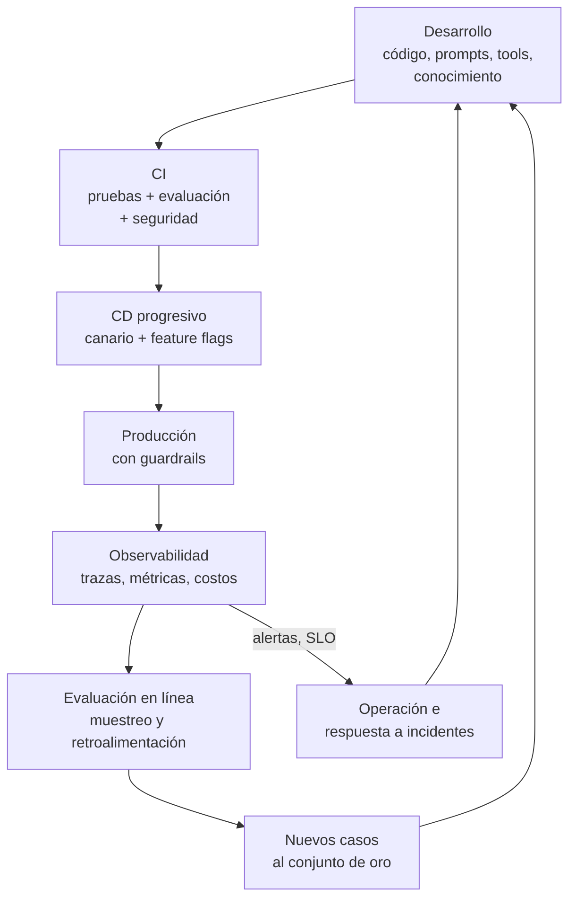
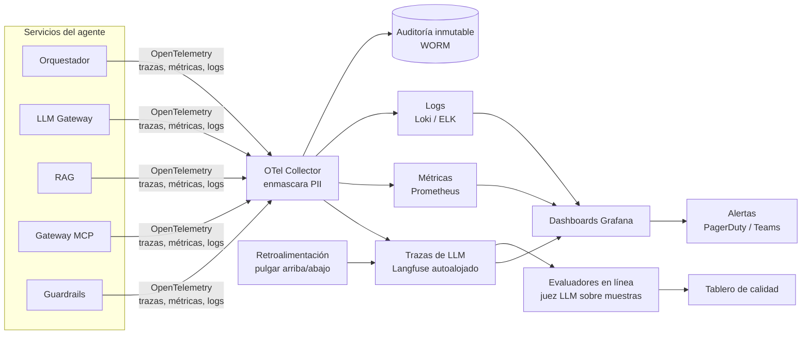
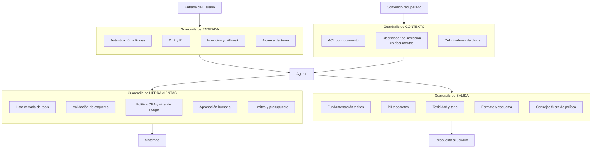
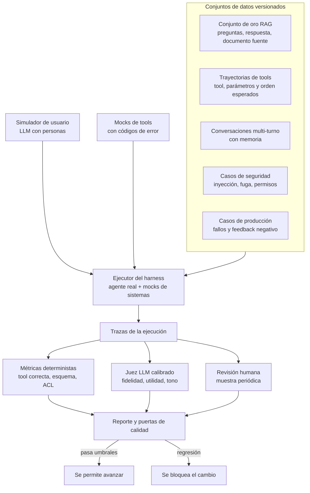
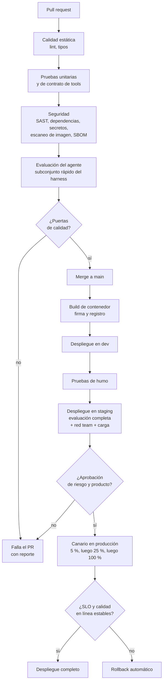

# 07. Observabilidad, monitoreo, guardrails, harness y CI/CD

> Responde al punto **7. Observabilidad, Monitoreo, CI/CD**: componentes y proceso que gobierna el desarrollo, despliegue y monitoreo, especificando guardrails, harness y pipelines.

[← Anterior: 06. Tools y skills](06_tools_y_skills.md) · [Índice](../README.md) · Siguiente: [08. Decisiones y gestión](08_decisiones_gestion_y_recursos.md)

---

## 1. Visión: un ciclo cerrado

La idea central: **cada fallo detectado en producción se convierte en un caso de prueba** que impide que vuelva a ocurrir.

---

## 2. Observabilidad

### 2.1 Arquitectura

**Traza por conversación**: un solo `trace_id` recorre canal, guardrails, memoria, RAG, LLM y tools. Cada paso es un *span* con entradas, salidas (enmascaradas), latencia, tokens, modelo y versión del prompt. Se usan las convenciones semánticas de OpenTelemetry para IA generativa.

### 2.2 Métricas

| Categoría | Métrica | Meta inicial |
|---|---|---|
| **Calidad** | Tasa de resolución sin escalar | > 70 % |
| | Fidelidad (muestreo con juez + humanos) | > 95 % |
| | Pulgar arriba / abajo | > 85 % positivas |
| | Alucinaciones detectadas | < 1 % |
| **Agente** | Pasos promedio por turno | < 4 |
| | Éxito de tool calling (tool y parámetros correctos) | > 95 % |
| | Tasa de escalamiento a humano | Monitoreada, tendencia |
| | Bucles o presupuesto agotado | < 1 % |
| **Rendimiento** | Latencia primer token P95 | < 3 s |
| | Latencia total P95 (simple / con tools) | < 12 s / < 25 s |
| | Latencia por etapa (guardrails, RAG, LLM, tool) | Alertas por etapa |
| **Costo** | Tokens y costo por conversación y por usuario | Tope por área |
| | Tasa de aciertos de caché | > 30 % en FAQs |
| | % de llamadas por nivel de modelo (S/M/L) | S+M > 95 % |
| **Confiabilidad** | Disponibilidad | 99,5 % |
| | Error por tool y por código | < 2 % |
| | Circuit breakers abiertos | 0 sostenido |
| **Seguridad** | Bloqueos de guardrails por tipo | Tendencia y picos |
| | Intentos de inyección detectados | Alertas ante picos |
| | Accesos a datos de clientes fuera de patrón | 0 sin revisión |
| **Conocimiento** | Edad promedio de documentos indexados | Alertas por desactualización |
| | Documentos más citados con retroalimentación negativa | Cola de revisión |

### 2.3 SLO y alertas

| SLO | Objetivo | Alerta |
|---|---|---|
| Disponibilidad de la API | 99,5 % mensual | Consumo del presupuesto de error > 50 % en 7 días |
| Latencia P95 | < 12 s | > 15 s durante 10 min |
| Éxito de tools | > 98 % | < 95 % durante 15 min |
| Costo diario | Presupuesto por área | > 120 % del promedio móvil |
| Calidad en línea | Fidelidad > 95 % | Caída > 3 puntos frente a la semana previa |
| Seguridad | Sin fugas | Cualquier detección de PII en la salida → alerta inmediata |

### 2.4 Detección de deriva

- **Deriva de modelo**: los proveedores actualizan modelos; las versiones se **fijan** y una evaluación **nocturna** sobre el conjunto de oro detecta regresiones.
- **Deriva de conocimiento**: documentos obsoletos o nuevos sin cobertura (preguntas frecuentes sin respuesta).
- **Deriva de uso**: nuevas intenciones que el supervisor clasifica como "otro" con frecuencia.

### 2.5 Privacidad de la telemetría

Las trazas y logs **enmascaran PII** en el colector, con acceso por roles y retención limitada (por ejemplo 30 a 90 días en trazas completas; la auditoría de acciones se conserva según la política de retención regulatoria).

---

## 3. Guardrails

### 3.1 Capas

### 3.2 Detalle

| Capa | Control | Implementación sugerida | Acción al fallar |
|---|---|---|---|
| Entrada | Autenticación, cuotas, tamaño de mensaje | API Gateway, límites por usuario | Rechazo con mensaje claro |
| Entrada | PII y datos sensibles (cédula, tarjeta, claves) | Presidio o DLP de la nube, enmascaramiento | Enmascarar o pedir que no los comparta |
| Entrada | Inyección de prompt y *jailbreak* | Clasificador (Llama Guard / Prompt Shields / Bedrock Guardrails) | Bloquear y registrar |
| Entrada | Alcance (solo temas corporativos) | Clasificador del supervisor | Redirigir amablemente |
| Contexto | Control de acceso por documento | Filtros ACL en la consulta | No recuperar |
| Contexto | Inyección indirecta en documentos o resultados | Clasificador sobre el contenido recuperado + delimitadores | Descartar fragmento y alertar al dueño |
| Herramientas | Solo tools permitidas para el especialista y el rol | Catálogo cerrado en el gateway MCP | Rechazar la llamada |
| Herramientas | Parámetros válidos y seguros | JSON Schema, listas permitidas, rangos | `VALIDATION_ERROR` |
| Herramientas | Autorización por riesgo | OPA con políticas como código | `POLICY_DENIED` o solicitar aprobación |
| Herramientas | Acciones de riesgo | Nodo HITL en el grafo | Pausar hasta aprobar |
| Herramientas | Abuso o bucles | Presupuesto de pasos, rate limit y límite de consultas a clientes | Detener y escalar |
| Salida | Fundamentación (afirmaciones respaldadas) | Verificador (NLI / juez S) y exigencia de citas | Regenerar una vez, o responder con cautela |
| Salida | Fuga de PII o secretos | Escáner de salida | Enmascarar o bloquear |
| Salida | Toxicidad y tono | Content Safety | Reemplazar por respuesta segura |
| Salida | Asesoría fuera de política (legal, financiera al cliente) | Reglas y clasificador | Aviso y derivación |

Marco de referencia: **OWASP Top 10 para aplicaciones LLM**, **NIST AI RMF** y la gestión de riesgo de modelos de la entidad. Los guardrails son **defensa en profundidad**: ninguno depende de que el modelo "se porte bien".

---

## 4. Harness de evaluación

El *harness* es el banco de pruebas que ejecuta el agente completo (con tools simuladas) sobre casos conocidos y puntúa el resultado. Es lo que permite **cambiar prompts, modelos o chunking sin miedo**.

| Tipo de prueba | Qué valida | Herramienta posible |
|---|---|---|
| **Unitarias** | Funciones, parsers, ensamblador de contexto, validadores | pytest |
| **Contrato de tools** | Esquemas, errores y versiones | Pruebas de contrato (Pact / esquemas JSON) |
| **RAG** | Recuperación y generación (doc 05) | RAGAS, DeepEval |
| **Trayectorias del agente** | Tool y parámetros correctos, número de pasos, terminación | Evaluaciones de LangSmith / Langfuse / promptfoo |
| **Conversaciones multi-turno** | Memoria, resumen y aclaraciones | Simulador de usuario |
| **Seguridad (*red teaming*)** | Inyección, fuga entre usuarios, escalamiento de privilegios, exfiltración | promptfoo, Garak, pruebas propias |
| **Carga y resiliencia** | Concurrencia, caída de proveedores, tools lentas | k6 / Locust + inyección de fallos |
| **Regresión de modelo** | Cambio de versión del LLM | Mismo conjunto de oro, comparación lado a lado |

**Puertas de calidad (ejemplo)**: fidelidad ≥ 0,95; éxito de tools ≥ 95 %; fuga de ACL = 0; casos de inyección bloqueados ≥ 98 %; regresión máxima de 2 puntos en cualquier métrica; costo por conversación ≤ +10 % del línea base.

El **juez LLM** se calibra contra etiquetas humanas (acuerdo mínimo definido) y usa un modelo distinto al que se evalúa para reducir sesgo.

---

## 5. CI/CD

### 5.1 Qué se versiona

| Artefacto | Dónde | Cómo se despliega |
|---|---|---|
| Código de servicios | Git (monorepo o repos por servicio) | Contenedores |
| **Prompts y skills** | Git + registro de prompts (versión, hash) | Configuración con *feature flag* |
| Esquemas y servidores MCP | Git | Contenedores + registro de contratos |
| Políticas OPA | Git | Bundle de políticas |
| Infraestructura | Terraform | Pipeline de infraestructura |
| Conjuntos de evaluación | Git LFS / almacén versionado | Usados por CI |
| Conocimiento (índices) | Pipeline de ingesta | Alias blue-green de índice |
| Selección de modelos | Configuración del gateway | Cambio gradual |

### 5.2 Pipeline de aplicación

### 5.3 Pipelines complementarios

| Pipeline | Disparador | Etapas | Resultado |
|---|---|---|---|
| **Conocimiento** | Cambios en fuentes (eventos / programado) | Detectar cambios → parsear → chunking → embeddings → índice nuevo → pruebas de calidad y recuperación → cambio de alias | Índice publicado o alerta sin publicar |
| **Evaluación continua** | Nocturno y semanal | Conjunto de oro completo sobre producción-like, comparación con línea base, *red team* | Reporte y alertas de deriva |
| **Prompts y configuración** | PR en el registro de prompts | Evaluación del harness → *feature flag* al 5 % → ampliación | Cambio de prompt sin redeploy del servicio |
| **Cambio de modelo** | Nueva versión del proveedor | Comparación lado a lado en el conjunto de oro y costos → canario | Aprobación explícita antes de usarlo |
| **Infraestructura** | PR de Terraform | Plan, revisión, políticas (OPA/Checkov), aplicación | Infra reproducible |
| **Retroalimentación** | Casos negativos en producción | Triage semanal → casos nuevos en el conjunto de oro | El mismo fallo no se repite |

### 5.4 Entornos y controles

| Entorno | Datos | Acceso | Notas |
|---|---|---|---|
| **dev** | Sintéticos | Equipo de desarrollo | Tools simuladas |
| **staging** | Sintéticos + copia anonimizada | Equipo + QA + riesgo | Réplica de producción, carga y *red team* |
| **producción** | Reales | Mínimo privilegio, acceso temporal | Canario, *feature flags* y rollback |

Prácticas: **GitOps** (ArgoCD / Flux), firma de imágenes, SBOM, gestión de secretos en bóveda, aprobaciones por entorno y registro de cambios para auditoría. Los **cambios de modelo, prompts o políticas de riesgo** requieren revisión del área de riesgo de modelos (MRM).

---

## 6. Gobierno y operación

| Aspecto | Práctica |
|---|---|
| **Roles** | Dueño de producto, ingeniería de plataforma, ingeniería de IA/ML, seguridad, riesgo de modelos, dueños de conocimiento |
| **Gestión del cambio** | Clasificación de cambios (estándar, normal, de emergencia) y comité de cambios para R3/R4 |
| **Runbooks** | Caída del proveedor LLM (failover), índice corrupto (rollback de alias), pico de costos (reducir nivel de modelo), incidente de seguridad (apagado selectivo de tools) |
| **Interruptor de emergencia** | *Kill switch* por tool, por especialista o por canal, sin redeploy |
| **Respuesta a incidentes** | Severidades, rotación de guardia, post-mortem sin culpables y casos nuevos al conjunto de oro |
| **Auditoría y cumplimiento** | Trazabilidad completa de acciones, modelo, prompt y contexto usados; informes periódicos a riesgo y cumplimiento |
| **FinOps** | Tablero de costo por área, alertas de presupuesto, revisión mensual de enrutamiento de modelos (doc 08) |

---

[← Anterior: 06. Tools y skills](06_tools_y_skills.md) · [Índice](../README.md) · Siguiente: [08. Decisiones y gestión](08_decisiones_gestion_y_recursos.md)
