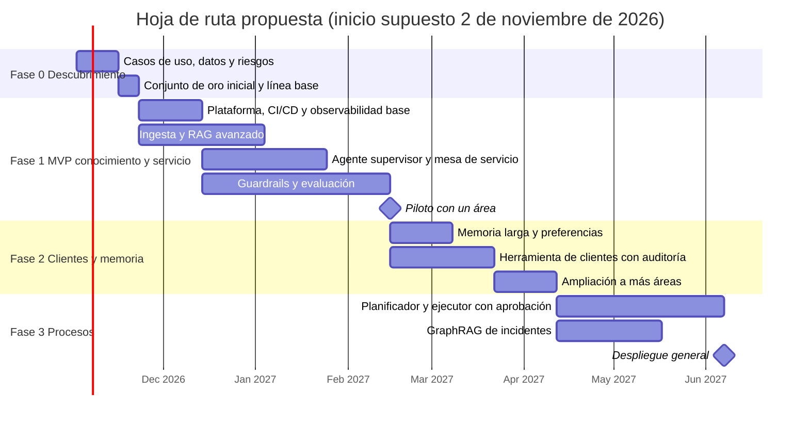

# 08. Decisiones, gestión del proyecto y uso óptimo de recursos

> Documento de apoyo a las decisiones de componentes, herramientas e integraciones, y a los criterios de evaluación: **gestión de proyecto** y **uso óptimo de recursos**.

[← Anterior: 07. Observabilidad y CI/CD](07_observabilidad_guardrails_cicd.md) · [Índice](../README.md)

---

## 1. Registro de decisiones de arquitectura (ADR)

| ID | Decisión | Contexto | Alternativas | Consecuencias |
|---|---|---|---|---|
| **ADR-01** | **Agente híbrido** sobre grafo con estado (supervisor + especialistas + planificador condicionado) | Mezcla de consultas simples y procesos con riesgo; necesidad de auditoría | ReAct puro, agente único, multi-agente libre | Previsible y auditable; algo más de diseño inicial |
| **ADR-02** | **LangGraph** como orquestador | Se requieren estado persistente, interrupciones HITL y *streaming* | Semantic Kernel, agentes administrados, desarrollo propio | Dependencia de un framework en evolución: se aísla tras una interfaz propia |
| **ADR-03** | **LLM Gateway** y modelos **por niveles** (S/M/L) | Costo, latencia y riesgo de dependencia de un proveedor | Un solo modelo grande, llamada directa | Ahorro de costo y *fallback*; requiere mantener el enrutamiento |
| **ADR-04** | Modelos en **nube privada** de la entidad, sin retención ni entrenamiento con datos | Normativa, confidencialidad | API pública | Menor elección de modelos; mayor cumplimiento |
| **ADR-05** | **RAG avanzado + componente agéntico**, GraphRAG en fase 2 | Corpus heterogéneo, normativo, con permisos | RAG ingenuo, GraphRAG total | Mayor precisión y seguridad; más etapas que evaluar |
| **ADR-06** | **Búsqueda híbrida** con filtros ACL en consulta | Términos exactos y permisos por documento | Solo vectorial | Se requiere sincronizar permisos |
| **ADR-07** | **Redis + PostgreSQL/pgvector** para memoria | Latencia en sesión y consultas semánticas y relacionales | Un vector DB dedicado, solo Redis | Menos piezas; se podrá migrar si crece el volumen |
| **ADR-08** | Herramientas como **servidores MCP** tras un gateway | Reutilización entre agentes, seguridad central, equipos desacoplados | Funciones embebidas | Una pieza más que operar; contrato estándar |
| **ADR-09** | **Identidad delegada (OBO)** para tools | El agente no debe tener más permisos que el usuario | Cuenta de servicio | Requiere soporte en sistemas destino |
| **ADR-10** | **Políticas como código (OPA)** y niveles de riesgo R0–R4 | Auditabilidad y separación entre "proponer" y "autorizar" | Reglas en prompts | Los cambios de política pasan por revisión |
| **ADR-11** | **Aprobación humana** para R2 en adelante | Responsabilidad en acciones con efecto | Autonomía total | Más fricción: se mide y se relaja con evidencia |
| **ADR-12** | **Observabilidad con OpenTelemetry + Langfuse autoalojado** | Datos sensibles y estándar abierto | SaaS de terceros | Operar la plataforma; control total de datos |
| **ADR-13** | **Evaluación continua como puerta de calidad** en CI/CD | El comportamiento del LLM cambia con prompts y modelos | Pruebas manuales | Inversión inicial en conjuntos de oro |
| **ADR-14** | Arquitectura **agnóstica a la nube** con mapeo de servicios | La entidad puede tener su nube preferida | Acoplamiento a una nube | Pequeño costo de abstracción |

---

## 2. Gestión del proyecto

### 2.1 Enfoque

Entrega **incremental por valor y riesgo**: primero lo de **solo lectura** (conocimiento), luego acciones reversibles y por último procesos críticos. Cada fase termina con un **piloto medido** y una decisión de continuar, ajustar o detener (*go / no-go*). La evaluación se construye desde la primera semana, no al final.

### 2.2 Hoja de ruta



| Fase | Alcance | Criterio de salida (go / no-go) |
|---|---|---|
| **0. Descubrimiento** (3 sem) | Priorizar casos, inventariar fuentes y permisos, definir riesgos y KPIs, armar conjunto de oro y línea base | Casos priorizados, fuentes accesibles, KPIs acordados |
| **1. MVP** (~12 sem) | Canal Teams y web, RAG avanzado, mesa de servicio (R0–R2), guardrails y observabilidad, CI/CD con evaluación | Fidelidad ≥ 0,95; resolución ≥ 60 %; 0 fugas; piloto con satisfacción ≥ 80 % |
| **2. Clientes y memoria** (~8 sem) | Memoria larga, `get_customer_info` (R3), más áreas | Auditoría validada por riesgo; sin hallazgos críticos |
| **3. Procesos** (~8 sem) | Planificador-ejecutor (R4), GraphRAG de incidentes, despliegue general | Aprobación de riesgo, pruebas de compensación y *kill switch* verificados |

Los plazos son una **estimación inicial** que se ajusta tras la fase 0.

### 2.3 Equipo (roles)

| Rol | Responsabilidad | Dedicación inicial |
|---|---|---|
| Dueño de producto | Prioridades, KPIs, adopción | Parcial |
| Líder técnico / arquitecto | Arquitectura, ADR, calidad técnica | Completa |
| Ingeniería de IA (2) | Agente, RAG, evaluación, prompts | Completa |
| Ingeniería de plataforma / DevOps (1) | Infra, CI/CD, observabilidad | Completa |
| Ingeniería de integraciones (1 a 2) | Servidores MCP y conectores | Completa |
| Seguridad y riesgo de modelos | Guardrails, políticas, revisiones | Parcial |
| Dueños de conocimiento (por área) | Calidad y vigencia de documentos | Parcial |
| Diseño de conversación y QA | Experiencia, casos de prueba | Parcial |

### 2.4 Comunicación y seguimiento

- **Cadencia**: sprints de 2 semanas con demo al cierre; revisión mensual con riesgo y cumplimiento.
- **Visibilidad**: tablero de KPIs de producto y calidad accesible al patrocinador.
- **Decisiones**: toda decisión relevante se registra como ADR.
- **Gestión del cambio**: capacitación breve, canal de retroalimentación, campeones por área y guías de uso.

### 2.5 Riesgos principales

| Riesgo | Prob. | Impacto | Mitigación |
|---|---|---|---|
| Conocimiento desactualizado o desordenado | Alta | Alto | Dueños por documento, pipeline con versionado, alertas de antigüedad, cola de revisión por retroalimentación |
| Alucinaciones en políticas | Media | Alto | RAG con citas, control de suficiencia, verificador de fundamentación, métrica de fidelidad como puerta |
| Fuga de información por permisos | Baja | Muy alto | ACL en consulta, OBO, pruebas de no fuga en CI, auditoría |
| Inyección de prompt | Media | Alto | Defensa en profundidad, lista cerrada de tools, aprobación humana |
| Acción incorrecta sobre un sistema | Baja | Alto | Niveles de riesgo, confirmación, idempotencia, compensación, *kill switch* |
| Sobrecosto de tokens | Media | Medio | Niveles de modelo, caché, compresión, topes y alertas |
| Dependencia de un proveedor | Media | Medio | LLM Gateway, versiones fijadas, segundo proveedor |
| Baja adopción | Media | Alto | Canales donde ya trabajan, casos de mayor dolor primero, medición y mejora continua |
| Calidad de integraciones heredadas | Alta | Medio | Mocks, pruebas de contrato, circuit breakers, degradación elegante |
| Regulación cambiante | Media | Medio | Revisión periódica con cumplimiento, política como código ajustable |

### 2.6 KPIs de éxito

| Dimensión | KPI | Meta a 6 meses (referencia) |
|---|---|---|
| Valor | Tiempo ahorrado por consulta frente a buscar manualmente | −50 % |
| | Consultas resueltas sin intervención humana | ≥ 70 % |
| | Tickets creados con datos completos al primer intento | ≥ 90 % |
| Adopción | Empleados activos mensuales / habilitados | ≥ 60 % |
| Calidad | Satisfacción (pulgar arriba) | ≥ 85 % |
| | Fidelidad en políticas | ≥ 95 % |
| Seguridad | Fugas confirmadas | 0 |
| Eficiencia | Costo por conversación vs. presupuesto | ≤ 100 % |

---

## 3. Uso óptimo de recursos

### 3.1 Palancas de optimización

| Palanca | Qué se hace | Efecto esperado |
|---|---|---|
| **Enrutamiento por niveles** | Tareas simples en modelo S; M solo cuando se necesita; L excepcional | Reduce costo de inferencia sin perder calidad en lo crítico |
| **Contexto mínimo suficiente** | Capas, presupuesto y compresión (doc 04) | Menos tokens y menor latencia |
| **Prompt caching** | Prefijo estable (sistema + esquemas) cacheado | Menor costo y latencia del prefijo |
| **Caché semántica de FAQs** | Responder repetidas sin llamar al LLM grande | Menos llamadas al nivel M |
| **Selección dinámica de tools** | Solo las del especialista activo | Menos tokens y menos errores |
| **Reranking selectivo** | Recuperar amplio, rerankear, enviar poco | Mejor precisión con menos contexto |
| **Ingesta incremental** | Reprocesar solo lo que cambió | Menos cómputo y embeddings |
| **Procesamiento por lotes** | Tareas no interactivas (resúmenes de cierre, evaluaciones nocturnas) en modo batch | Menor costo por token |
| **Autoescalado** | Servicios sin estado escalan por demanda; escala a mínimo fuera de horario | Menor gasto de infraestructura |
| **Reutilización** | Servicios existentes de la organización (IdP, ITSM, observabilidad, gateway) | Menor tiempo y menos plataformas nuevas |
| **Presupuestos y topes** | Por usuario, área y turno; alertas | Evita sobrecostos |
| **Modelos abiertos donde conviene** | Embeddings, reranker y guardrails autoalojados si el volumen lo justifica | Control y costo marginal bajo |
| **Medir antes de optimizar** | Telemetría por capa y por modelo | Optimizaciones basadas en datos |

### 3.2 Ejemplo ilustrativo de presupuesto de tokens por turno

Cifras de referencia para dimensionar; se validan con medición real.

| Concepto | Enfoque ingenuo | Enfoque propuesto |
|---|---|---|
| Prompt de sistema + esquemas de **todas** las tools | ~9.000 | ~3.500 (solo el especialista) |
| Historial | Completo (~15.000) | ~3.000 (resumen + últimos turnos) |
| Conocimiento recuperado | 15 fragmentos (~12.000) | 6 fragmentos reranqueados (~5.000) |
| Resultados de tools | Volcado completo (~5.000) | Proyección (~2.000) |
| Memoria | — | ~450 |
| **Total entrada aproximada** | **~41.000** | **~14.000** |
| Modelo usado | Siempre el grande | S para enrutar y guardrails; M para responder |

Reducción de tokens de entrada del orden de **dos tercios** antes de aplicar caché de prefijo, con un efecto adicional por usar modelos más pequeños en las tareas auxiliares.

### 3.3 Modelo de costo para dimensionar

```text
Costo mensual ≈ conversaciones/mes
              × Σ por llamada ( tokens_entrada × precio_entrada(modelo)
                              + tokens_salida  × precio_salida(modelo) )
              × (1 − ahorro_caché)
              + infraestructura (cómputo, almacenamiento, búsqueda)
              + licencias y operación
```

Los precios los fija cada proveedor y cambian con frecuencia, por eso **se calcula en la fase 0 con tarifas vigentes** y el tablero de FinOps compara el costo real contra este modelo cada mes.

### 3.4 Dimensionamiento inicial (supuestos)

| Parámetro | Supuesto |
|---|---|
| Empleados habilitados | 5.000 |
| Usuarios activos diarios | 15 – 25 % |
| Conversaciones por usuario activo y día | 2 – 3 |
| Turnos por conversación | 4 – 6 |
| Concurrencia pico | ~300 conversaciones |
| Corpus inicial | decenas de miles de documentos, centenas de miles de fragmentos |

Con estos valores, el índice híbrido y las bases de datos caben en configuraciones medianas; el cuello de botella de costo está en los **tokens de inferencia**, no en la infraestructura, de ahí el énfasis en contexto y enrutamiento.

---

## 4. Supuestos y límites de este diseño

- Es un **diseño de referencia**: la implementación final depende de la nube, los sistemas y las restricciones regulatorias de la entidad.
- Los valores numéricos (umbrales, plazos, tamaños, metas) son **puntos de partida** a calibrar con datos reales.
- Los nombres de productos son ejemplos de la categoría; la selección final se hace con una **prueba comparativa** (calidad, latencia, costo, seguridad y soporte).
- No se desarrolla la aplicación: el enunciado pide el diseño.

---

## 5. Glosario

| Término | Significado |
|---|---|
| **ACL** | Lista de control de acceso: quién puede ver cada documento |
| **ADR** | Registro de decisión de arquitectura |
| **HITL** | Humano en el ciclo: aprobación antes de ejecutar |
| **MCP** | Model Context Protocol, estándar para exponer herramientas a agentes |
| **OBO** | *On-behalf-of*: el servicio actúa con la identidad del usuario |
| **OPA** | Open Policy Agent: motor de políticas como código |
| **RAG** | Generación aumentada por recuperación |
| **RRF** | *Reciprocal Rank Fusion*: método para combinar rankings |
| **Conjunto de oro** | Casos de referencia con resultado esperado para evaluar |
| **Harness** | Banco de pruebas que ejecuta y puntúa al agente |
| **MRM** | Gestión de riesgo de modelos |
| **SLO** | Objetivo de nivel de servicio |

---

[← Anterior: 07. Observabilidad y CI/CD](07_observabilidad_guardrails_cicd.md) · [Índice](../README.md)
